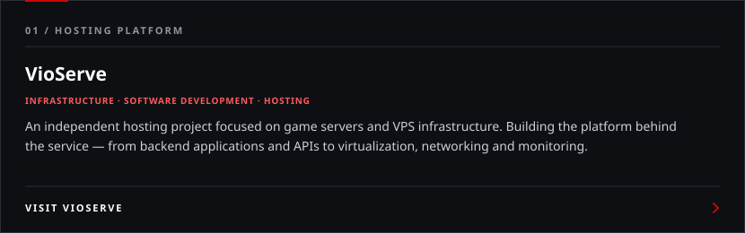
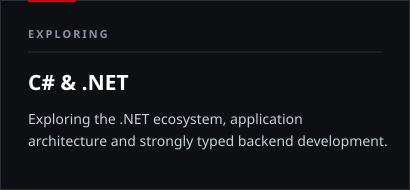
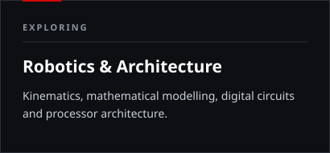

 

  

    

  

    
    
    
  

   

  <h3>Software Developer & Infrastructure Engineer</h3>

  

    I build software, design infrastructure and operate the systems behind it. 
    Working across the stack — from backend applications to production infrastructure.
  

 

<h2 align="center">01 &nbsp; / &nbsp; About me</h2>

  My work sits at the intersection of software engineering and systems engineering.

 

  
  
  

  

<h2 align="center">02 &nbsp; / &nbsp; Selected projects</h2>

 

  
   
  
  
   
   
  
  
  
  

  

<h2 align="center">03 &nbsp; / &nbsp; Technology stack</h2>

 

  <h3>Development</h3>

   

  

     

  <h3>Infrastructure & Operations</h3>

   

  

     

  <h3>Platforms & Tools</h3>

   

  

    
    
    
    
    
  

  

<h2 align="center">04 &nbsp; / &nbsp; Currently exploring</h2>

 

  
  
   
  
  

  

<h2 align="center">05 &nbsp; / &nbsp; GitHub activity</h2>

 

  

  

     

  

  

<h2 align="center">06 &nbsp; / &nbsp; Elsewhere</h2>

 

  
  
  
  

    

  ENGINEERED WITH CURIOSITY. BUILT TO RUN.

     

  

