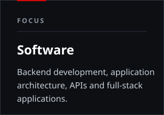
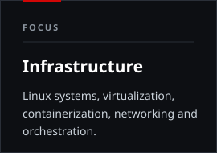
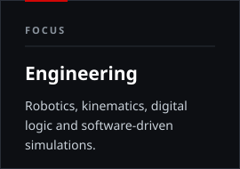
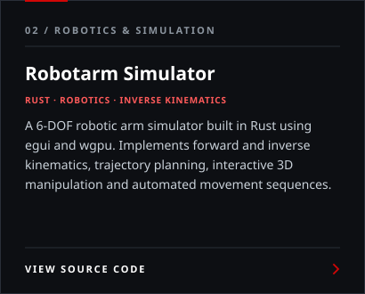
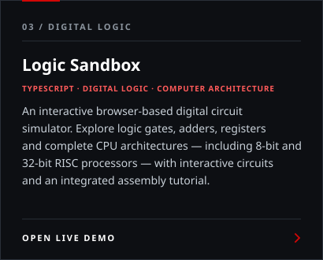
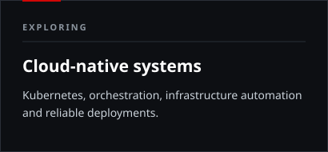
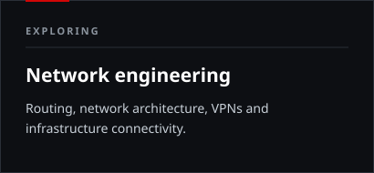

<h3>Software Developer & Infrastructure Engineer</h3>

I build software, design infrastructure and operate the systems behind it. 
Working across the stack — from backend applications to production infrastructure.

<h2>01 &nbsp; / &nbsp; About me</h2>

<h2>02 &nbsp; / &nbsp; Selected projects</h2>

 

<h2>03 &nbsp; / &nbsp; Technology stack</h2>

 
 

<h2>04 &nbsp; / &nbsp; Currently exploring</h2>

<h2>05 &nbsp; / &nbsp; Elsewhere</h2>

ENGINEERED WITH CURIOSITY. BUILT TO RUN.

